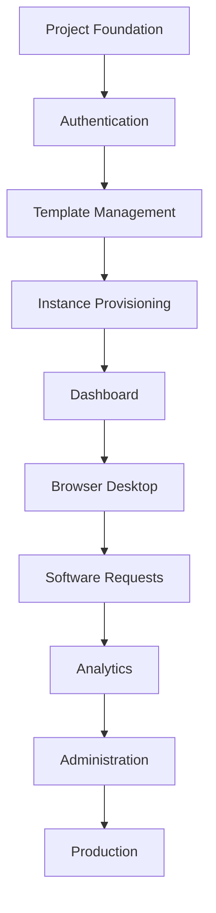

# Desktop Cloud Platform
# Development Roadmap

**Document Version:** 1.0.0

**Product Version:** MVP (v1.0.0)

**Status:** Approved

**Depends On:**
- 01A_Executive_Summary.md
- 01B_Product_Overview.md
- 01C_Product_Principles.md

---

# Table of Contents

1. Purpose
2. Development Philosophy
3. Project Milestones
4. Vertical Slice Development
5. Milestone Breakdown
6. Feature Dependencies
7. Version Roadmap
8. Coding Agent Guidelines
9. Definition of Done
10. Release Checklist

---

# 1. Purpose

This document defines **how the Desktop Cloud Platform will be developed**.

It acts as the implementation roadmap for developers and AI coding agents, ensuring that development follows a logical sequence and that every feature is completed before moving to the next.

This roadmap prioritizes delivering a stable, working product over implementing many partially completed features.

---

# 2. Development Philosophy

The project follows four guiding principles during implementation.

## 2.1 Vertical Slice Development

Every feature should be implemented completely before beginning another.

A slice is complete only when it includes:

- Backend implementation
- Database changes
- API endpoints
- Frontend UI
- Testing
- Documentation
- Event logging

Avoid leaving incomplete or placeholder implementations.

---

## 2.2 Simplicity First

Choose the simplest maintainable solution.

Do not introduce frameworks, libraries, or abstractions without a clear need.

---

## 2.3 Production Mindset

Even during local development, code should be written as if it will eventually run in production.

Examples:

- Proper logging
- Error handling
- Configuration through environment variables
- Secure defaults

---

## 2.4 Documentation Driven

Documentation is part of the product.

Whenever a feature changes:

- Update documentation.
- Update API references.
- Update architecture diagrams if required.

---

# 3. Project Milestones

The MVP is divided into the following milestones.

| Milestone | Name | Status |
|-----------|------|--------|
| M1 | Project Foundation | Done |
| M2 | Authentication | Done |
| M3 | Template Management | Done |
| M4 | Instance Provisioning | Done |
| M5 | Instance Dashboard | Done |
| M6 | Browser Desktop Access | Done |
| M7 | Software Request Workflow | Done |
| M8 | Analytics & Event Logging | Planned |
| M9 | Administration Portal | Planned |
| M10 | Production Deployment | Planned |

---

# 4. Vertical Slice Development

The following workflow must be followed for every milestone.

```text
Requirements
      │
Database
      │
Backend Services
      │
REST API
      │
Frontend
      │
Testing
      │
Documentation
      │
Review
      │
Complete
```

A slice is not complete until every step has been finished.

---

# 5. Milestone Breakdown

## M1 – Project Foundation

Objective:

Create the development foundation.

Deliverables:

- Django project
- React project
- PostgreSQL
- Redis
- Celery
- Docker Compose
- Environment configuration
- Logging framework
- Basic CI structure (future-ready)
- Base folder structure

Acceptance Criteria:

- Project starts successfully.
- Backend and frontend communicate.
- Database connection established.
- Background worker operational.

---

## M2 – Authentication

Deliverables:

- User registration
- Login
- Logout
- Session authentication
- Password reset
- User profile
- Role management

Acceptance Criteria:

- Users authenticate successfully.
- Secure session cookies enabled.
- Protected routes function correctly.

---

## M3 – Template Management

Deliverables:

- JSON-based templates
- Template CRUD
- Admin management
- Template validation

Acceptance Criteria:

- Templates are selectable during instance creation.
- Invalid templates are rejected.

---

## M4 – Instance Provisioning

Deliverables:

- Instance ordering
- Validation
- Celery jobs
- Docker provisioning
- Resource limits
- Persistent storage
- Auto-stop configuration

Acceptance Criteria:

- Users can provision new instances.
- Containers start successfully.
- Database state matches Docker state.

---

## M5 – Instance Dashboard

Deliverables:

- Running instances
- Stopped instances
- Usage information
- Start
- Stop
- Restart
- Delete

Acceptance Criteria:

- Dashboard accurately reflects instance status.

---

## M6 – Browser Desktop Access

Deliverables:

- noVNC integration
- Traefik routing
- Hash-based subdomains
- Session validation
- Friendly error pages

Acceptance Criteria:

- Users can launch their desktop through a browser.
- Unauthorized users cannot access another user's desktop.

---

## M7 – Software Request Workflow

Deliverables:

- Request creation
- Admin approval
- Installation queue
- Completion tracking
- Notifications (future)

Acceptance Criteria:

- Requests move through the full lifecycle successfully.

---

## M8 – Analytics & Event Logging

Deliverables:

- Event log
- User activity
- Instance statistics
- Dashboard metrics

Acceptance Criteria:

- Significant platform actions generate event logs.
- Analytics display accurate data.

---

## M9 – Administration Portal

Deliverables:

- User management
- Instance management
- Template management
- Software request approval
- Platform analytics

Acceptance Criteria:

- Administrators can manage the platform without database access.

---

## M10 – Production Deployment

Deliverables:

- Production configuration
- HTTPS
- Traefik
- Automated backups
- Monitoring
- Logging
- Disaster recovery documentation

Acceptance Criteria:

- Platform deploys successfully on a production Ubuntu server.

---

# 6. Feature Dependencies



Features should not be developed before their dependencies are complete.

---

# 7. Version Roadmap

## Version 1.0

Core platform.

Includes:

- Authentication
- Templates
- Desktop provisioning
- Dashboard
- Browser access
- Administration
- Logging

---

## Version 1.1

Quality improvements.

Includes:

- Better analytics
- Enhanced monitoring
- Performance optimizations
- Improved administration

---

## Version 1.2

Platform enhancements.

Includes:

- Advanced template management
- Software catalog
- Better reporting

---

## Version 2.0

Infrastructure scaling.

Includes:

- Multi-host scheduling
- Distributed Docker hosts
- Enhanced orchestration

---

## Version 3.0

Commercial platform.

Includes:

- Billing
- Projects
- Team collaboration
- Marketplace
- Public API
- CLI

---

# 8. Coding Agent Guidelines

Every AI coding agent contributing to this project must follow these rules.

## General Rules

- Never skip milestones.
- Never implement future features early.
- Follow the architecture documents.
- Prefer maintainable code over clever code.
- Do not duplicate business logic.
- Keep views thin.
- Place business logic in service classes.

---

## Vertical Slice Rules

Complete one slice before beginning another.

Every slice must include:

- Backend
- Database
- API
- Frontend
- Tests
- Documentation
- Event logging

---

## Docker Rules

- Never call Docker directly from API views.
- All Docker interactions must pass through DockerManager.
- Long-running Docker operations must execute through Celery.

---

## Documentation Rules

Every completed feature requires:

- Documentation update
- API documentation update
- Architecture review (if affected)

---

# 9. Definition of Done

A milestone is considered complete only when:

- Feature implemented
- Tests passing
- Documentation updated
- Event logging implemented
- Security reviewed
- Manual testing completed
- No known critical defects

---

# 10. Release Checklist

Before any release:

- Database migrations reviewed
- Environment variables documented
- API endpoints tested
- Event logs verified
- Background jobs verified
- Docker lifecycle tested
- Backups tested
- HTTPS verified
- Documentation updated
- Version tagged in Git

---

# End of Document