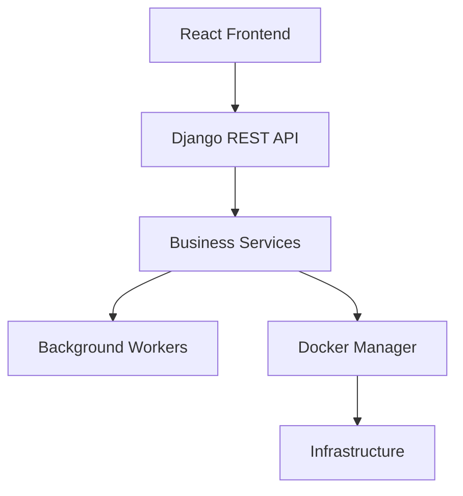
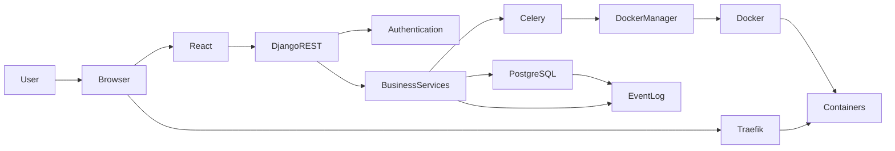
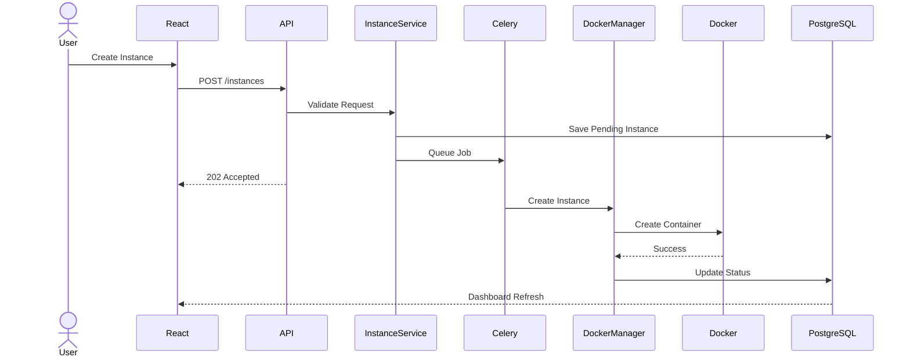
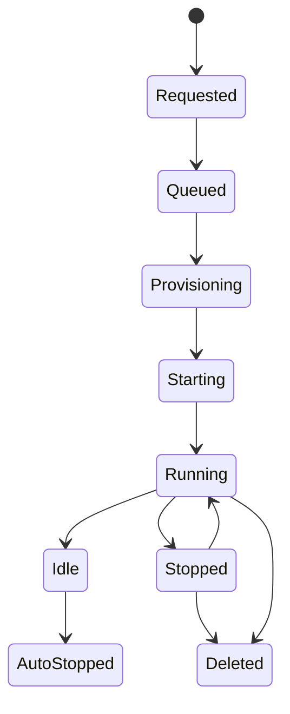
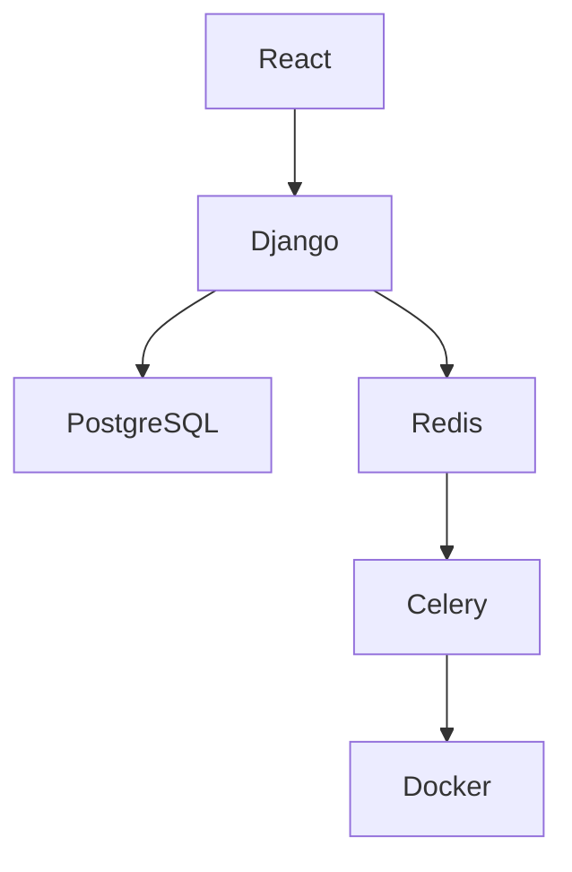
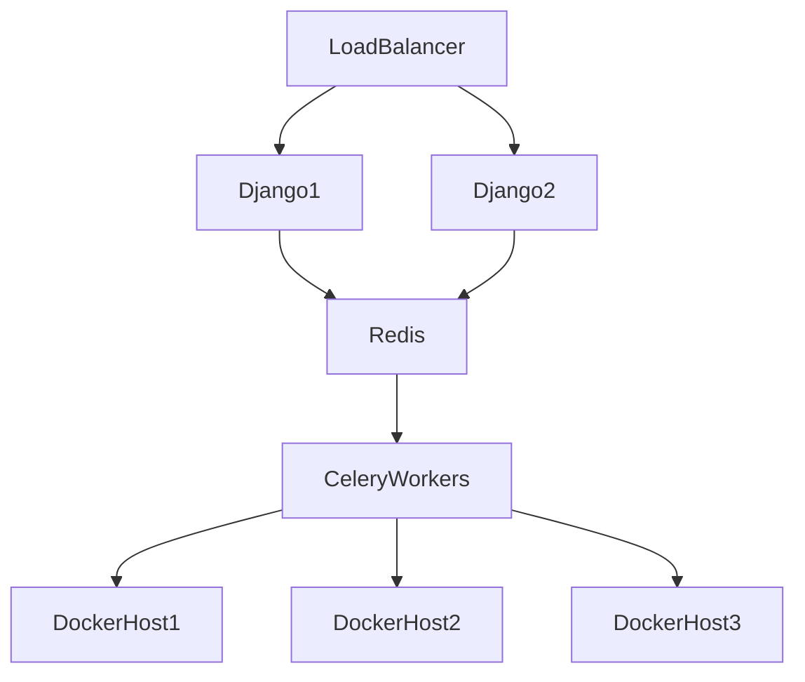

# Desktop Cloud Platform
# System Architecture

**Document Version:** 1.0.0

**Product Version:** MVP (v1.0.0)

**Status:** Approved

**Depends On:**
- 01A_Executive_Summary.md
- 01B_Product_Overview.md
- 01C_Product_Principles.md

---

# Table of Contents

1. Introduction
2. Architecture Overview
3. High-Level Architecture
4. Core Components
5. Request Lifecycle
6. Container Lifecycle
7. Service Responsibilities
8. Data Flow
9. Design Decisions
10. Failure Handling
11. Scalability
12. Future Architecture
13. Acceptance Criteria

---

# 1. Introduction

This document describes the overall software architecture of the Desktop Cloud Platform.

It defines the major system components, how they interact, and the responsibilities of each subsystem.

This architecture intentionally follows a layered design to ensure maintainability, extensibility, and future scalability.

The Version 1 architecture targets a single Ubuntu server while avoiding design decisions that would make future horizontal scaling difficult.

---

# 2. Architecture Overview

The Desktop Cloud Platform consists of six major layers.

Each layer has a clearly defined responsibility.

No layer should bypass another layer.

For example:

❌ React should never communicate directly with Docker.

❌ Views should never invoke Docker SDK functions.

Everything flows through the service layer.

---

# 3. High-Level Architecture

---

# 4. Core Components

## React Frontend

Responsibilities

- User Interface
- Dashboard
- Ordering Wizard
- Analytics
- Login
- Administration UI

Never responsible for:

- Business Logic
- Docker Operations
- Authentication Decisions

---

## Django REST API

Responsibilities

- Authentication
- Request Validation
- API Responses
- Session Management

Never responsible for:

- Docker orchestration
- Background processing

---

## Business Services

This is the heart of the platform.

Responsibilities

- Business rules
- Validation
- Authorization
- Workflow coordination

Example services:

- AuthenticationService
- InstanceService
- TemplateService
- AnalyticsService
- SoftwareRequestService

---

## Celery Workers

Responsibilities

Long-running tasks:

- Create containers
- Delete containers
- Install software
- Analytics generation
- Cleanup jobs

Workers should never expose HTTP endpoints.

---

## Docker Manager

The Docker Manager is the only component permitted to communicate with Docker.

Responsibilities

- Create containers
- Delete containers
- Start containers
- Stop containers
- Restart containers
- Volume management
- Network configuration
- Labels
- Resource limits

Future compatibility:

The Docker Manager should later be replaceable with Kubernetes without affecting higher layers.

---

## PostgreSQL

Stores:

- Users
- Instances
- Templates
- Analytics
- Volumes
- Software Requests
- Event Logs
- Admin Logs

---

## Traefik

Responsibilities

- HTTPS
- Automatic certificates
- Reverse proxy
- Hash-based routing
- Session validation
- Container discovery

---

# 5. Request Lifecycle

Example: Create Instance

---

# 6. Container Lifecycle

Every state transition generates an Event Log.

---

# 7. Service Responsibilities

## Authentication Service

Responsible for:

- Login
- Logout
- Sessions
- Password reset
- Authorization

---

## Instance Service

Responsible for:

- Provisioning requests
- Validation
- Ownership
- Resource allocation

---

## Docker Service

Responsible for:

- Docker SDK
- Networks
- Volumes
- Images
- Labels

---

## Analytics Service

Responsible for:

- Usage statistics
- Dashboard metrics
- Historical reporting

---

## Event Service

Responsible for:

- Audit trail
- Platform events
- User events
- Admin events

---

# 8. Data Flow

User Action

↓

React

↓

REST API

↓

Business Service

↓

Background Queue

↓

Docker

↓

Database Update

↓

Dashboard Refresh

---

# 9. Design Decisions

## Why Layered Architecture?

Advantages:

- Easy testing
- Clear responsibilities
- Replaceable components
- Easier maintenance

---

## Why Service Classes?

Advantages:

- Reusable logic
- Thin views
- Easier testing
- Better separation of concerns

---

## Why Background Jobs?

Advantages:

- Better responsiveness
- Scalability
- Reliability
- Retry support

---

## Why Event Logging?

Advantages:

- Auditing
- Analytics
- Troubleshooting
- User history

---

# 10. Failure Handling

Failures should never leave the platform in an inconsistent state.

Example:

If Docker successfully creates a container but PostgreSQL update fails:

- Retry database update.
- Log failure.
- Mark instance for reconciliation.
- Never silently ignore failures.

---

# 11. Scalability

Version 1

Single Host

Future

The application should not assume only one Docker host exists.

---

# 12. Future Architecture

The following enhancements should require minimal architectural changes:

- Projects
- Billing
- Multi-host scheduler
- Docker Swarm
- Kubernetes
- Public API
- Marketplace
- CLI

This validates the architectural choices made for Version 1.

---

# 13. Acceptance Criteria

The architecture is considered complete when:

- Layer responsibilities are defined.
- Service boundaries are documented.
- Request lifecycle is documented.
- Container lifecycle is documented.
- Data flow is documented.
- Scalability path is defined.
- Future compatibility is maintained.

---

# End of Document