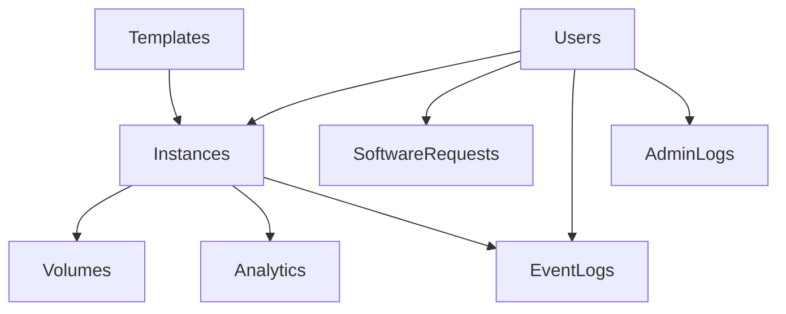
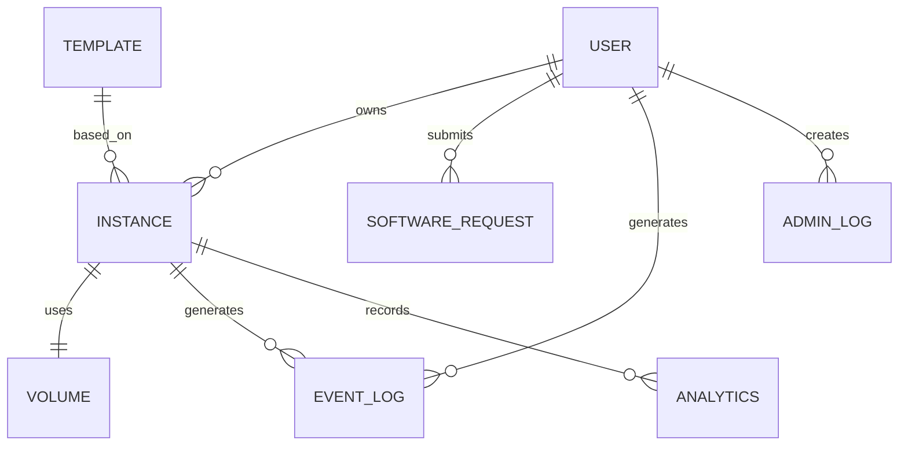

# Desktop Cloud Platform
# Database Design

**Document Version:** 1.0.0

**Product Version:** MVP (v1.0.0)

**Status:** Approved

**Depends On:**
- 01A_Executive_Summary.md
- 01B_Product_Overview.md
- 01C_Product_Principles.md
- 01D_Development_Roadmap.md
- 02_System_Architecture.md

---

# Table of Contents

1. Overview
2. Design Philosophy
3. Database Architecture
4. Schema Organization
5. Naming Conventions
6. Global Standards
7. Entity Relationship Diagram
8. Table Specifications
9. Indexing Strategy
10. Constraints
11. Data Integrity
12. Soft Deletes
13. Audit Fields
14. Future Expansion
15. Migration Strategy
16. Acceptance Criteria

---

# 1. Overview

PostgreSQL is the primary persistent datastore for the Desktop Cloud Platform.

The database stores all business metadata required by the platform.

**Important:**

The database **does not store desktop data**.

Desktop files belong to Docker volumes on the host filesystem.

The database stores only references to those volumes.

---

# 2. Design Philosophy

The database is designed around the following principles.

- Normalized data
- Explicit relationships
- Minimal duplication
- Strong referential integrity
- Auditability
- Future scalability

Every record must have a clear owner.

Every foreign key must have a documented deletion policy.

Every mutable object should be auditable.

---

# 3. Database Architecture

The MVP uses a **single PostgreSQL database**.



---

# 4. Schema Organization

Instead of placing everything in one schema, logical separation is used through Django applications.

| Django App | Primary Tables |
|------------|----------------|
| accounts | users |
| instances | instances |
| templates | templates |
| volumes | volumes |
| analytics | analytics |
| events | event_logs |
| software_requests | software_requests |
| administration | admin_logs |

This keeps ownership clear while remaining inside a single PostgreSQL database.

---

# 5. Naming Conventions

## Tables

Use plural snake_case.

Examples

```
users
instances
templates
event_logs
software_requests
```

---

## Primary Keys

Every table uses

```
id
```

Type:

```
UUID
```

Reason:

UUIDs avoid exposing sequential identifiers through public APIs and simplify future multi-host synchronization.

---

## Foreign Keys

Use

```
user_id
instance_id
template_id
volume_id
```

---

## Timestamp Fields

Every mutable table includes:

```
created_at
updated_at
```

Where appropriate:

```
deleted_at
last_accessed_at
```

---

# 6. Global Standards

Every table should include:

| Column | Required |
|---------|----------|
| id | Yes |
| created_at | Yes |
| updated_at | Yes |

Where applicable:

| Column | Purpose |
|---------|---------|
| deleted_at | Soft delete |
| created_by | Auditing |
| updated_by | Auditing |

---

# 7. Entity Relationship Diagram



---

# 8. Table Specifications

---

# users

Purpose

Represents authenticated platform users.

Fields

| Column | Type | Notes |
|---------|------|------|
| id | UUID | Primary Key |
| username | VARCHAR(50) | Unique |
| email | VARCHAR(255) | Unique |
| password_hash | TEXT | Django managed |
| first_name | VARCHAR(100) | |
| last_name | VARCHAR(100) | |
| role | ENUM | USER / ADMIN / SUPER_ADMIN |
| is_active | BOOLEAN | |
| last_login | TIMESTAMP | |
| created_at | TIMESTAMP | |
| updated_at | TIMESTAMP | |

Indexes

- username
- email

---

# templates

Purpose

Defines desktop templates available during provisioning.

Fields

| Column | Type |
|---------|------|
| id | UUID |
| name | VARCHAR |
| slug | VARCHAR |
| description | TEXT |
| json_configuration | JSONB |
| enabled | BOOLEAN |
| created_at | TIMESTAMP |
| updated_at | TIMESTAMP |

---

# instances

Purpose

Represents desktop instances.

Fields

| Column | Type |
|---------|------|
| id | UUID |
| user_id | UUID |
| template_id | UUID |
| status | ENUM |
| hostname | VARCHAR |
| container_name | VARCHAR |
| container_hash | VARCHAR |
| cpu_limit | DECIMAL |
| memory_limit | INTEGER |
| persistent | BOOLEAN |
| internet_enabled | BOOLEAN |
| auto_stop_minutes | INTEGER |
| username | VARCHAR |
| created_at | TIMESTAMP |
| updated_at | TIMESTAMP |

Status values

```
Requested

Queued

Provisioning

Running

Idle

Stopped

Deleting

Deleted

Failed
```

---

# volumes

Purpose

Tracks persistent storage.

Fields

| Column | Type |
|---------|------|
| id | UUID |
| instance_id | UUID |
| host_path | TEXT |
| persistent | BOOLEAN |
| retain_after_delete | BOOLEAN |
| size_bytes | BIGINT |
| created_at | TIMESTAMP |

---

# software_requests

Purpose

Tracks user software installation requests.

Fields

| Column | Type |
|---------|------|
| id | UUID |
| user_id | UUID |
| instance_id | UUID |
| software_name | VARCHAR |
| justification | TEXT |
| status | ENUM |
| reviewed_by | UUID |
| reviewed_at | TIMESTAMP |
| created_at | TIMESTAMP |

Status

```
Pending

Approved

Rejected

Installing

Installed

Failed
```

---

# analytics

Purpose

Stores aggregated metrics.

Fields

| Column | Type |
|---------|------|
| id | UUID |
| instance_id | UUID |
| cpu_average | FLOAT |
| ram_average | FLOAT |
| uptime_seconds | BIGINT |
| last_calculated | TIMESTAMP |

---

# event_logs

Purpose

Immutable audit trail.

Fields

| Column | Type |
|---------|------|
| id | UUID |
| user_id | UUID |
| instance_id | UUID |
| event_type | VARCHAR |
| severity | ENUM |
| description | TEXT |
| metadata | JSONB |
| created_at | TIMESTAMP |

Severity

```
INFO

WARNING

ERROR

CRITICAL
```

---

# admin_logs

Purpose

Audit administrator actions.

Fields

| Column | Type |
|---------|------|
| id | UUID |
| admin_id | UUID |
| action | VARCHAR |
| target | VARCHAR |
| metadata | JSONB |
| created_at | TIMESTAMP |

---

# 9. Indexing Strategy

Indexes should exist on:

- username
- email
- user_id
- instance_id
- template_id
- status
- created_at

Composite indexes:

```
(user_id, status)

(instance_id, created_at)

(status, created_at)
```

---

# 10. Constraints

Examples

- Username unique
- Email unique
- Container name unique
- Hostname unique
- Template slug unique

Foreign keys should use:

```
ON DELETE RESTRICT
```

unless explicitly documented otherwise.

---

# 11. Data Integrity

Rules

- Every instance belongs to one user.
- Every volume belongs to one instance.
- Every template may serve many instances.
- Event logs are immutable.
- Analytics are append-only.

---

# 12. Soft Deletes

Use soft deletes only for business entities.

Soft delete:

- users
- instances

Hard delete:

- analytics
- logs
- temporary jobs

Persistent volumes remain according to the user's retention choice.

---

# 13. Audit Fields

Every mutable entity records:

- created_at
- updated_at

Business entities additionally record:

- created_by
- updated_by

where applicable.

---

# 14. Future Expansion

Schema reserved for:

- Billing
- Projects
- Teams
- Marketplace
- API Keys
- Notifications
- Multi-host scheduling

The current design should accommodate these additions without breaking existing tables.

---

# 15. Migration Strategy

Guidelines

- Use Django migrations exclusively.
- Never modify migrations after release.
- Prefer additive changes.
- Avoid destructive migrations.
- Test migrations against production-like data.

---

# 16. Acceptance Criteria

The database design is complete when:

- Every entity is documented.
- Relationships are defined.
- Naming conventions are established.
- Constraints are documented.
- Indexes are identified.
- Future expansion is considered.
- Migration strategy is defined.

---

# End of Document