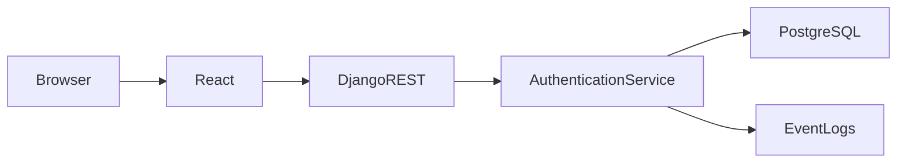
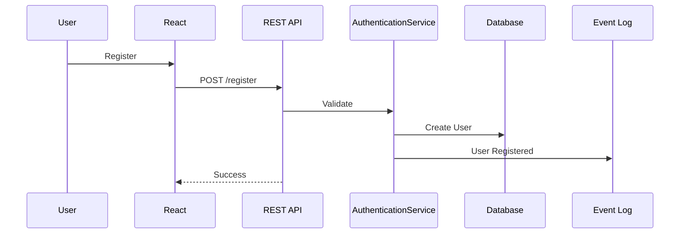
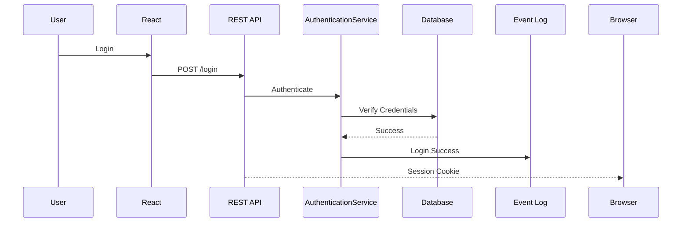

# Desktop Cloud Platform
# Authentication & Security

**Document Version:** 1.0.0

**Product Version:** MVP (v1.0.0)

**Status:** Approved

**Depends On:**
- 01A_Executive_Summary.md
- 01B_Product_Overview.md
- 01C_Product_Principles.md
- 01D_Development_Roadmap.md
- 02_System_Architecture.md
- 03_Database_Design.md

**Referenced Components:**
- users table
- event_logs table
- instances table
- AuthenticationService
- DockerManager
- REST Authentication API

---

# Table of Contents

1. Overview
2. Security Principles
3. Authentication Architecture
4. Authorization Model
5. Session Management
6. Password Management
7. User Registration
8. Login Workflow
9. Protected Resources
10. Security Layers
11. Docker Security
12. Instance Security
13. API Security
14. Event Logging
15. Future Security Enhancements

---

# 1. Overview

Authentication and security form the foundation of the Desktop Cloud Platform.

Every request that accesses user resources must be authenticated and authorized.

Security is implemented in multiple independent layers rather than relying on a single protection mechanism.

The platform follows a **Defense in Depth** approach.

---

# 2. Security Principles

## SP-001 – Secure by Default

The safest configuration should always be the default.

Examples:

- HTTPS only
- Secure cookies
- Rootless containers
- Resource limits enabled
- User namespaces enabled

---

## SP-002 – Least Privilege

Every component receives only the permissions required to perform its task.

Examples:

- Users never receive Docker host access.
- Containers never receive unnecessary Linux capabilities.
- Django never exposes Docker sockets directly to users.

---

## SP-003 – Zero Trust Between Containers

Containers should never trust one another.

Each instance is isolated and cannot access:

- Other containers
- Other users' files
- Docker host filesystem
- Docker daemon

---

## SP-004 – Auditability

Every security-sensitive action must be recorded in the Event Log.

Examples:

- Login
- Logout
- Failed login
- Password reset
- Instance creation
- Instance deletion
- Admin actions

---

# 3. Authentication Architecture

Authentication uses Django's built-in authentication system.



Authentication is performed once.

Authorization is checked on every protected request.

---

# 4. Authorization Model

## User Roles

### USER

Permissions:

- Manage own instances
- View own analytics
- Submit software requests
- View own event history

Cannot:

- Access other users' resources
- Manage templates
- View platform analytics
- Access admin dashboard

---

### ADMIN

Permissions:

- Manage users
- Manage templates
- Approve software requests
- View analytics
- Manage instances
- View audit logs

---

### SUPER_ADMIN

Permissions:

Everything available to ADMIN plus:

- Manage administrators
- Platform configuration
- Emergency maintenance operations

---

# 5. Session Management

Authentication uses secure session cookies.

Cookie configuration:

| Setting | Value |
|---------|-------|
| HttpOnly | Enabled |
| Secure | Enabled |
| SameSite | Strict |
| Expiration | Configurable |

Session expiration:

- Idle timeout
- Manual logout
- Password change
- Admin session invalidation

---

# 6. Password Management

Passwords are never stored in plaintext.

Django's password hashing mechanism is used.

Requirements:

- Minimum length
- Mixed case
- Numbers
- Special characters

Password reset:

- Email-based reset token
- Single use
- Time-limited

---

# 7. User Registration

Registration flow:



Validation includes:

- Unique username
- Unique email
- Password policy
- Required fields

---

# 8. Login Workflow



Failed logins:

- Logged
- Rate limited
- Generic error returned

Never disclose whether the username or password was incorrect.

---

# 9. Protected Resources

The following resources require authentication:

- Dashboard
- Instance management
- Browser desktop access
- Analytics
- Software requests
- Event history
- User profile

Administrative resources additionally require ADMIN or SUPER_ADMIN roles.

---

# 10. Security Layers

The platform uses multiple layers of protection.

| Layer | Purpose |
|--------|---------|
| HTTPS | Encrypt traffic |
| Session Cookies | Authentication |
| Role Checks | Authorization |
| Django CSRF | Request protection |
| Rate Limiting | Abuse prevention |
| Docker Isolation | Runtime security |
| Traefik | Reverse proxy |
| Event Logs | Auditing |

---

# 11. Docker Security

Cross-reference:
See **05_Container_Architecture.md**

All containers shall:

- Run rootless
- Use user namespaces
- Have CPU limits
- Have memory limits
- Use isolated networking
- Run with minimal Linux capabilities
- Use dedicated persistent volumes (if enabled)

Containers never run in privileged mode.

---

# 12. Instance Security

Every instance belongs to exactly one user.

Validation occurs before every action.

Example:

User A requests:

```
POST /instances/{id}/start
```

The backend verifies:

- User is authenticated
- Instance exists
- User owns the instance
- Instance is not deleted

Only then is the Docker operation queued.

---

# 13. API Security

Every protected endpoint requires authentication.

Examples:

```
GET /instances

POST /instances

POST /instances/{id}/start

DELETE /instances/{id}

GET /analytics
```

Authorization checks occur inside the service layer.

API Views must never bypass authorization.

---

# 14. Event Logging

The following actions generate Event Log entries:

| Action | Logged |
|---------|--------|
| Register | Yes |
| Login | Yes |
| Logout | Yes |
| Failed Login | Yes |
| Password Reset | Yes |
| Create Instance | Yes |
| Delete Instance | Yes |
| Start Instance | Yes |
| Stop Instance | Yes |
| Restart Instance | Yes |
| Admin Actions | Yes |

Cross-reference:

See:

- event_logs table
- 03_Database_Design.md

---

# 15. Future Security Enhancements

Version 1 intentionally excludes:

- OAuth
- Google Login
- GitHub Login
- Multi-factor authentication
- Single Sign-On
- WebAuthn
- Hardware security keys

Planned future enhancements:

- OAuth providers
- MFA
- API tokens
- Session management UI
- Device history
- Login notifications
- IP allowlists
- Admin approval workflow

---

# Acceptance Criteria

Authentication and security are complete when:

- Users can securely register.
- Users can log in.
- Sessions are protected.
- Authorization is enforced.
- Docker isolation is documented.
- Security-sensitive actions generate audit logs.
- Future security enhancements are identified.

---

# End of Document