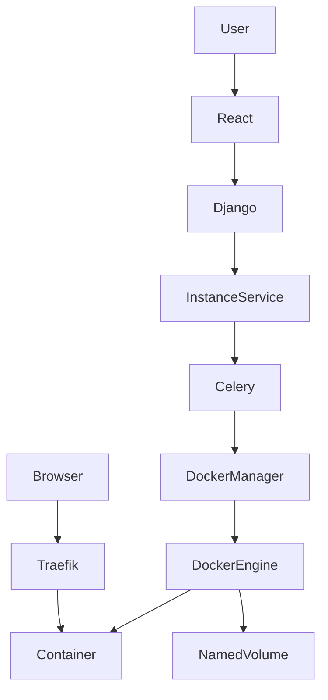
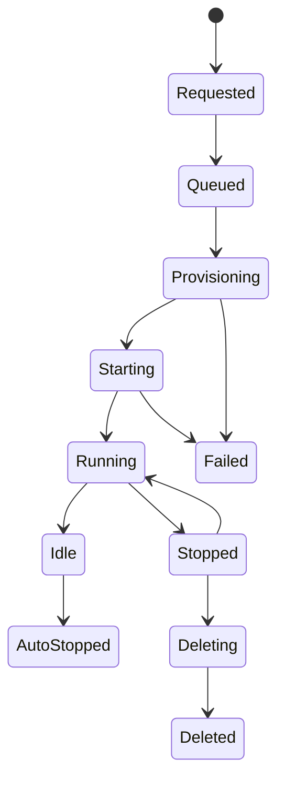
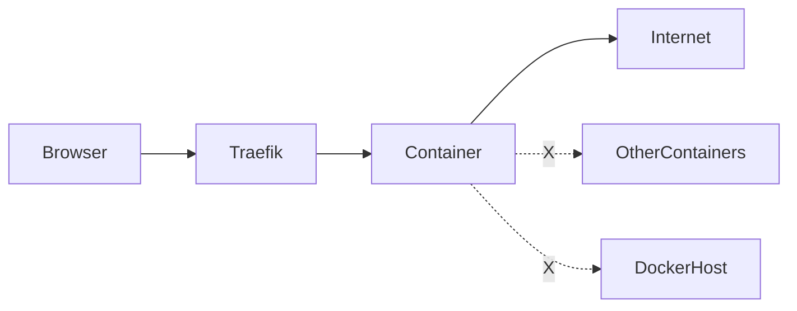
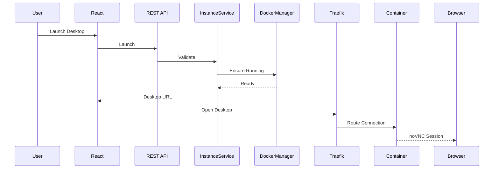
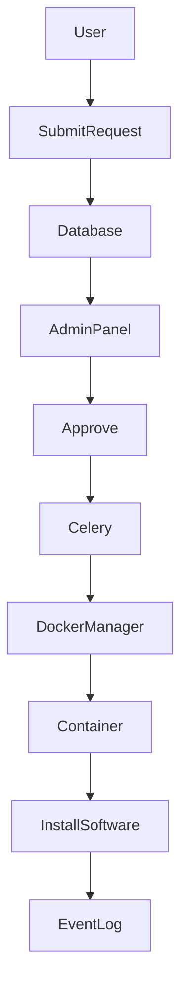

# Desktop Cloud Platform
# Container Architecture

**Document Version:** 1.0.0

**Product Version:** MVP (v1.0.0)

**Status:** Approved

**Depends On:**
- 01A_Executive_Summary.md
- 01B_Product_Overview.md
- 01C_Product_Principles.md
- 01D_Development_Roadmap.md
- 02_System_Architecture.md
- 03_Database_Design.md
- 04_Authentication_and_Security.md

**Cross References:**
- instances table
- templates table
- volumes table
- DockerManager
- InstanceService
- Traefik
- Event Logs

---

# Table of Contents

1. Overview
2. Container Philosophy
3. Architecture Overview
4. Base Images
5. Template System
6. Container Lifecycle
7. Container States
8. Naming Strategy
9. Networking
10. Storage Architecture
11. Resource Management
12. Security Model
13. Browser Access
14. Auto Stop
15. Software Installation Workflow
16. Docker Manager Responsibilities
17. Failure Recovery
18. Future Evolution

---

# 1. Overview

The Desktop Cloud Platform provisions isolated Linux desktop environments using Docker containers.

Each user instance is represented by exactly one Docker container.

The platform abstracts Docker from the user, exposing only high-level instance management through the web interface.

The container layer is responsible for:

- Desktop execution
- User isolation
- Resource enforcement
- Persistent storage
- Browser access
- Lifecycle management

---

# 2. Container Philosophy

Every container should be:

- Disposable
- Replaceable
- Reproducible
- Isolated
- Secure

A container should never become unique because of manual changes.

Persistent user data belongs in volumes, not inside the container filesystem.

---

# 3. Architecture Overview



---

# 4. Base Images

Containers are created from predefined templates.

Each template corresponds to a Docker image.

Examples:

| Template | Purpose |
|-----------|----------|
| XFCE + Brave | General desktop |
| XFCE + Developer Tools | Programming |
| XFCE + Minimal | Lightweight |
| Future Templates | Custom images |

Images are versioned.

Example:

```
desktop-base:v1.0
desktop-dev:v1.0
desktop-minimal:v1.0
```

Users cannot modify base templates.

---

# 5. Template System

Templates are stored in the database as JSON configurations.

Example configuration:

```json
{
  "name": "XFCE + Brave",
  "image": "desktop-base:v1.0",
  "memory": "2G",
  "cpus": 2,
  "internet": true,
  "persistent_supported": true
}
```

The DockerManager interprets this configuration during provisioning.

---

# 6. Container Lifecycle



Every state transition generates an Event Log.

---

# 7. Container States

| State | Description |
|--------|-------------|
| Requested | User submitted request |
| Queued | Waiting for worker |
| Provisioning | Docker resources being created |
| Starting | Container booting |
| Running | Ready for use |
| Idle | No user activity |
| AutoStopped | Stopped by idle timer |
| Stopped | User stopped instance |
| Deleting | Cleanup in progress |
| Deleted | Removed |
| Failed | Error occurred |

---

# 8. Naming Strategy

Internal names are never exposed to users.

Container naming convention:

```
dcp-{instance_uuid}
```

Example:

```
dcp-8e4cb2fa
```

Hostnames:

```
inst-8e4cb2fa
```

Public URLs use secure hashes.

Example:

```
f82a91c.desktop.example.com
```

The hash is generated by the platform and mapped internally to the instance.

---

# 9. Networking

The platform uses:

- Rootless Docker
- User namespaces
- Macvlan networking
- Traefik reverse proxy

Network architecture:



Containers cannot communicate with one another unless explicitly enabled in a future release.

Internet access is configurable during instance creation.

---

# 10. Storage Architecture

## Non-Persistent Instances

No dedicated volume is created.

Deleting the instance permanently removes all data.

---

## Persistent Instances

Each persistent instance receives a dedicated host directory.

Example:

```
Volumes/

└── user_001/

    ├── container_001/

    ├── container_002/

    └── container_003/
```

When deleting a persistent instance, users choose:

- Delete instance and data
- Delete instance but retain data

Retained volumes remain detached until reused or manually deleted.

---

# 11. Resource Management

Each instance has configurable resource limits.

| Resource | Configurable |
|----------|--------------|
| CPU | Yes |
| RAM | Yes |
| Persistent Storage | Yes |
| Internet | Yes |
| Auto Stop | Yes |

Free tier limits:

Defined in platform configuration.

Paid tiers:

Override default limits.

Resource limits are enforced by Docker.

---

# 12. Security Model

Containers use:

- Rootless Docker
- User namespaces
- Minimal Linux capabilities
- Read-only base image where practical
- Isolated filesystem
- Dedicated volumes
- Dedicated network identity

Privileged containers are prohibited.

Docker socket access is never exposed inside containers.

---

# 13. Browser Access

Desktop access occurs through noVNC.

Connection flow:



Traefik validates the authenticated session before routing traffic.

If the instance is stopped, users receive a friendly page explaining that the container is not running.

---

# 14. Auto Stop

Each instance may define an idle timeout.

Examples:

- Disabled
- 30 minutes
- 1 hour
- 2 hours
- 6 hours

Idle detection uses user activity within the noVNC session.

When the timeout expires:

1. Event logged
2. Container gracefully stopped
3. Dashboard updated

Persistent data is preserved when applicable.

---

# 15. Software Installation Workflow

The platform supports administrator-assisted software installation.

Workflow:



The administrator accesses the container using elevated privileges on the host, not by granting root access to the user.

Every installation request is recorded in the audit log.

---

# 16. DockerManager Responsibilities

DockerManager is the only component permitted to communicate with Docker.

Responsibilities:

- Create containers
- Delete containers
- Start containers
- Stop containers
- Restart containers
- Create volumes
- Remove volumes
- Configure networks
- Apply labels
- Apply resource limits
- Health checks
- Image validation

No other service communicates directly with Docker.

---

# 17. Failure Recovery

The platform should recover gracefully from failures.

Examples:

## Container Creation Fails

- Mark instance as Failed
- Record Event Log
- Preserve request details
- Allow retry

---

## Container Stops Unexpectedly

- Update database status
- Record failure
- Notify dashboard
- Allow manual restart

---

## Volume Mount Failure

- Abort provisioning
- Roll back container creation
- Log error
- Mark instance as Failed

---

## Docker Daemon Unavailable

- Queue operations
- Retry according to policy
- Surface status in the admin dashboard

---

# 18. Future Evolution

The architecture is intentionally designed to support:

- Multiple Docker hosts
- Docker Swarm
- Kubernetes
- GPU-enabled templates
- Snapshot support
- Automatic template updates
- Watchdog service
- High availability
- Live migration (future investigation)

These features should require extensions to DockerManager rather than major architectural redesign.

---

# Acceptance Criteria

The container architecture is complete when:

- Container lifecycle is documented.
- Networking is defined.
- Storage strategy is defined.
- Resource management is documented.
- Security boundaries are documented.
- Browser access flow is defined.
- DockerManager responsibilities are clearly specified.
- Failure recovery paths are documented.
- Future scalability is considered.

---

# End of Document