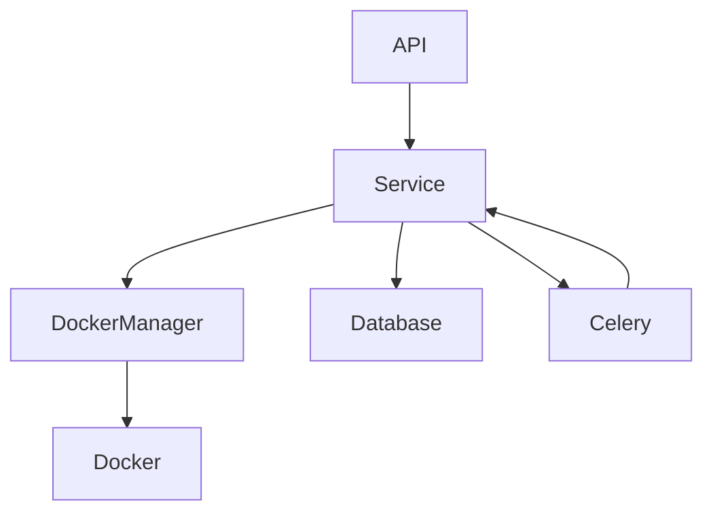
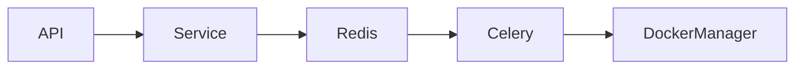
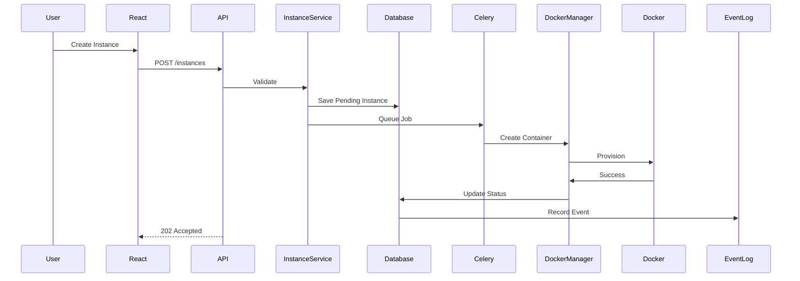

# Desktop Cloud Platform
# Backend Architecture

**Document Version:** 1.0.0

**Product Version:** MVP (v1.0.0)

**Status:** Approved

**Depends On:**
- 01A_Executive_Summary.md
- 01B_Product_Overview.md
- 01C_Product_Principles.md
- 01D_Development_Roadmap.md
- 02_System_Architecture.md
- 03_Database_Design.md
- 04_Authentication_and_Security.md
- 05_Container_Architecture.md

**Cross References:**
- REST API
- DockerManager
- Celery Workers
- Database Schema
- Event Logging

---

# Table of Contents

1. Purpose
2. Technology Stack
3. Project Structure
4. Django Application Layout
5. Layered Architecture
6. Service Layer
7. DockerManager
8. Celery Architecture
9. Configuration Management
10. Error Handling
11. Logging
12. Validation
13. API Response Standard
14. Database Transactions
15. Background Tasks
16. Signals
17. Testing Strategy
18. Coding Standards
19. Example Request Flow
20. Future Improvements

---

# 1. Purpose

The backend is responsible for orchestrating all platform operations.

It acts as the single source of truth for:

- Authentication
- Business logic
- Docker orchestration
- Persistence
- Authorization
- Analytics
- Event logging

The backend **never renders HTML pages**.

All communication occurs through REST APIs.

---

# 2. Technology Stack

| Component | Technology |
|-----------|------------|
| Language | Python 3.12+ |
| Framework | Django |
| API | Django REST Framework |
| Database | PostgreSQL |
| Cache | Redis |
| Background Jobs | Celery |
| Docker SDK | docker-py |
| Authentication | Django Sessions |
| Configuration | Environment Variables |
| Logging | Python Logging |
| Testing | Pytest + Django Test Framework |

---

# 3. Project Structure

```
backend/

├── config/
│   ├── settings/
│   ├── urls.py
│   ├── celery.py
│   └── wsgi.py
│
├── apps/
│   ├── accounts/
│   ├── instances/
│   ├── templates/
│   ├── analytics/
│   ├── events/
│   ├── software_requests/
│   ├── administration/
│   └── common/
│
├── services/
│
├── docker_manager/
│
├── tasks/
│
├── api/
│
├── tests/
│
├── scripts/
│
└── requirements/
```

Business logic should remain inside **services/**.

Infrastructure-specific code belongs in **docker_manager/**.

---

# 4. Django Application Layout

Each Django app owns a single business domain.

Example:

```
accounts/
    models.py
    serializers.py
    views.py
    urls.py
    services.py
    permissions.py
    tests.py
```

Responsibilities should never overlap.

---

# 5. Layered Architecture



Rules:

- Views are thin.
- Services contain business logic.
- DockerManager owns Docker.
- Celery owns long-running work.

---

# 6. Service Layer

Every major feature exposes a service class.

Examples:

```
AuthenticationService

InstanceService

TemplateService

AnalyticsService

SoftwareRequestService

EventLogService
```

Responsibilities:

- Validation
- Business rules
- Transactions
- Authorization
- Coordination

Services **must not** know about HTTP requests.

---

# 7. DockerManager

DockerManager is an infrastructure component.

Responsibilities:

- Create containers
- Delete containers
- Start containers
- Stop containers
- Restart containers
- Create volumes
- Configure networks
- Apply labels
- Health checks

No API view may directly import the Docker SDK.

---

# 8. Celery Architecture

Long-running operations execute asynchronously.

Examples:

- Create instance
- Delete instance
- Install software
- Analytics aggregation
- Auto-stop idle containers
- Cleanup jobs



Every task must:

- Log progress
- Handle retries
- Record failures

---

# 9. Configuration Management

All configuration comes from environment variables.

Examples:

```
DATABASE_URL

REDIS_URL

SECRET_KEY

DEBUG

DOCKER_HOST

TRAEFIK_DOMAIN

DEFAULT_CPU_LIMIT

DEFAULT_MEMORY_LIMIT
```

No secrets are committed to Git.

---

# 10. Error Handling

Errors are classified into:

| Type | Example |
|------|---------|
| Validation | Invalid request |
| Business | Quota exceeded |
| Infrastructure | Docker unavailable |
| Security | Unauthorized |
| Unexpected | Unknown exception |

Every error returns a standardized response.

Sensitive details must never be exposed.

---

# 11. Logging

Every request generates structured logs.

Log categories:

- API
- Docker
- Authentication
- Celery
- Event Logs
- Errors

Production logging should use JSON format.

---

# 12. Validation

Validation occurs in three stages:

1. Serializer validation
2. Service validation
3. Docker validation

Never rely solely on frontend validation.

---

# 13. API Response Standard

Successful response:

```json
{
  "success": true,
  "data": {},
  "message": "Instance created successfully."
}
```

Error response:

```json
{
  "success": false,
  "error": {
    "code": "INSTANCE_LIMIT_EXCEEDED",
    "message": "You have reached your instance limit."
  }
}
```

The response format should remain consistent across all endpoints.

---

# 14. Database Transactions

Business operations that modify multiple tables should use database transactions.

Example:

Creating an instance:

1. Create instance record.
2. Queue background job.
3. Create event log.

Either all succeed or all roll back.

---

# 15. Background Tasks

Tasks should be idempotent where possible.

Examples:

- Starting an already-running container should not fail.
- Stopping an already-stopped container should succeed gracefully.

Task states:

- Pending
- Running
- Retrying
- Completed
- Failed

---

# 16. Signals

Django signals should be used sparingly.

Acceptable uses:

- Automatically creating audit entries
- Updating analytics
- Cache invalidation

Avoid placing business logic inside signals.

Business workflows belong in services.

---

# 17. Testing Strategy

Each feature requires:

### Unit Tests

- Service logic
- Validation
- Utilities

### Integration Tests

- API endpoints
- Database
- Celery

### End-to-End Tests

- User workflow
- Docker lifecycle
- Browser desktop launch

Mock Docker where possible.

---

# 18. Coding Standards

- Use type hints.
- Follow PEP 8.
- Keep functions small.
- Prefer composition over inheritance.
- Avoid global state.
- Document public methods.

Naming conventions:

- Classes: PascalCase
- Functions: snake_case
- Constants: UPPER_CASE
- Variables: snake_case

---

# 19. Example Request Flow



---

# 20. Future Improvements

Potential backend enhancements:

- OpenAPI schema generation
- GraphQL API
- WebSocket notifications
- Distributed task queues
- Multi-host scheduling
- Service health dashboard
- Rate limiting middleware
- Feature flags
- Plugin system

These features should integrate without requiring major architectural changes.

---

# Acceptance Criteria

The backend architecture is complete when:

- Project structure is defined.
- Service layer responsibilities are documented.
- DockerManager boundaries are established.
- Celery architecture is documented.
- Configuration strategy is defined.
- Logging and error handling are standardized.
- Testing strategy is documented.
- Example request flow is provided.

---

# End of Document