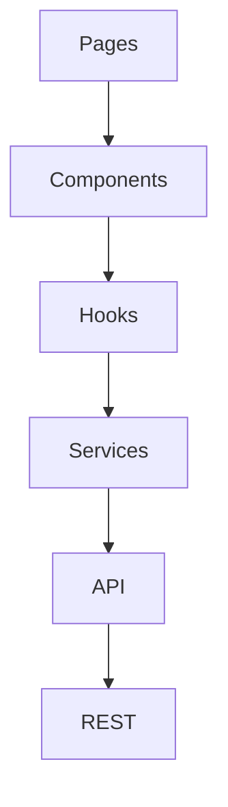

# Desktop Cloud Platform
# Frontend Architecture

**Document Version:** 1.0.0

**Product Version:** MVP (v1.0.0)

**Status:** Approved

**Depends On:**
- 01A_Executive_Summary.md
- 01B_Product_Overview.md
- 01C_Product_Principles.md
- 01D_Development_Roadmap.md
- 02_System_Architecture.md
- 03_Database_Design.md
- 04_Authentication_and_Security.md
- 05_Container_Architecture.md
- 06_Backend_Architecture.md
- 07_REST_API.md

**Cross References**
- REST API
- Authentication
- Container Architecture
- Backend Services

---

# Table of Contents

1. Purpose
2. Technology Stack
3. Design Principles
4. Application Architecture
5. Project Structure
6. Routing
7. Authentication Flow
8. State Management
9. API Layer
10. UI Component Architecture
11. Layout System
12. Forms
13. Tables
14. Notifications
15. Error Handling
16. Loading States
17. Theme & Styling
18. Build & Deployment
19. Coding Standards
20. Future Improvements

---

# 1. Purpose

The frontend provides a responsive web interface for interacting with the Desktop Cloud Platform.

Responsibilities include:

- Authentication
- Instance management
- Dashboard
- Software requests
- Analytics
- Administration
- Browser desktop launch

The frontend contains **no business logic**.

Business rules remain in the backend.

---

# 2. Technology Stack

| Component | Technology |
|-----------|------------|
| Framework | React 18 |
| Language | TypeScript |
| Build Tool | Vite |
| Routing | React Router |
| UI | Tailwind CSS |
| Components | shadcn/ui |
| Icons | Lucide React |
| Forms | React Hook Form |
| Validation | Zod |
| API | Axios |
| State | TanStack Query + React Context |
| Notifications | Sonner |

---

# 3. Design Principles

The frontend follows these principles:

- Responsive first
- Simple navigation
- Fast interactions
- Reusable components
- Accessibility by default
- Minimal dependencies

---

# 4. Application Architecture



Each layer has a single responsibility.

---

# 5. Project Structure

```
frontend/

src/

├── app/
├── assets/
├── components/
│
│   ├── common/
│
│   ├── dashboard/
│
│   ├── instances/
│
│   ├── templates/
│
│   ├── analytics/
│
│   └── admin/
│
├── hooks/
├── layouts/
├── pages/
├── routes/
├── services/
├── contexts/
├── types/
├── utils/
└── styles/
```

---

# 6. Routing

Routes are grouped by feature.

Examples:

```
/

/login

/register

/dashboard

/instances

/templates

/software-requests

/analytics

/profile

/admin
```

Protected routes require authentication.

---

# 7. Authentication Flow

```mermaid
sequenceDiagram

User->>Login Page

Login Page->>REST API

REST API-->>Browser

Browser->>Dashboard
```

Session validation occurs automatically when the application loads.

Expired sessions redirect users to the login page.

---

# 8. State Management

Global state should remain minimal.

React Context stores:

- Authenticated user
- Theme
- Application settings

TanStack Query stores:

- API responses
- Cached lists
- Background refresh
- Request status

Component state handles:

- Form values
- Modal visibility
- Local UI interactions

---

# 9. API Layer

The frontend communicates only through service modules.

Example:

```
AuthenticationService

InstanceService

TemplateService

AnalyticsService

AdminService
```

Components never call Axios directly.

---

# 10. UI Component Architecture

Reusable components include:

Common:

- Button
- Input
- Modal
- Dialog
- Card
- Badge
- Spinner
- Tooltip

Instance Components:

- InstanceCard
- InstanceTable
- ResourceBadge
- StatusIndicator
- LaunchButton

Admin Components:

- UserTable
- SoftwareRequestTable
- PlatformStatistics
- ActivityTimeline

---

# 11. Layout System

The application uses three layouts.

### Public Layout

- Login
- Register
- Forgot Password

---

### User Layout

- Sidebar
- Header
- Content
- Footer

---

### Admin Layout

Extends User Layout with:

- Additional navigation
- Administrative panels
- System health widgets

---

# 12. Forms

All forms use:

- React Hook Form
- Zod validation

Validation occurs:

1. Client-side
2. Server-side

Examples:

- Login
- Registration
- Create Instance
- Software Request
- Profile Update

---

# 13. Tables

Large datasets use reusable table components.

Supported features:

- Pagination
- Search
- Sorting
- Filtering
- Row actions
- Bulk selection (future)

Examples:

- Instance List
- Event Logs
- Users
- Software Requests

---

# 14. Notifications

User feedback uses toast notifications.

Examples:

Success:

```
Instance created successfully.
```

Error:

```
Unable to start instance.
```

Warning:

```
Your container will auto-stop in 5 minutes.
```

Future:

- Real-time notifications
- Notification center

---

# 15. Error Handling

Expected errors display friendly messages.

Unexpected errors display:

- Generic message
- Retry option
- Error ID (if available)

The UI never exposes stack traces.

---

# 16. Loading States

Every asynchronous operation should indicate progress.

Examples:

- Skeleton loaders
- Progress bars
- Loading spinners
- Disabled buttons during submission

Avoid blank screens whenever possible.

---

# 17. Theme & Styling

Primary styling:

- Tailwind CSS

Component library:

- shadcn/ui

Design goals:

- Clean
- Minimal
- Professional
- Dark mode support (future)
- Accessible color contrast

---

# 18. Build & Deployment

Development:

```
npm run dev
```

Production:

```
npm run build
```

Static assets are served independently from the Django backend.

---

# 19. Coding Standards

- Functional components only
- TypeScript required
- Hooks over class components
- One component per file
- Keep components focused
- Reuse shared components before creating new ones

Naming:

- Components: PascalCase
- Hooks: useX
- Utilities: camelCase
- Constants: UPPER_CASE

---

# 20. Future Improvements

Planned enhancements:

- Dark mode
- Internationalization (i18n)
- Offline support
- Progressive Web App
- Keyboard shortcuts
- Drag-and-drop dashboards
- Theme customization
- Real-time updates via WebSockets

---

# Acceptance Criteria

The frontend architecture is complete when:

- Project structure is defined.
- Routing is documented.
- State management is established.
- API integration strategy is documented.
- Layout system is defined.
- Component hierarchy is established.
- Styling standards are documented.
- Build process is defined.

---

# End of Document