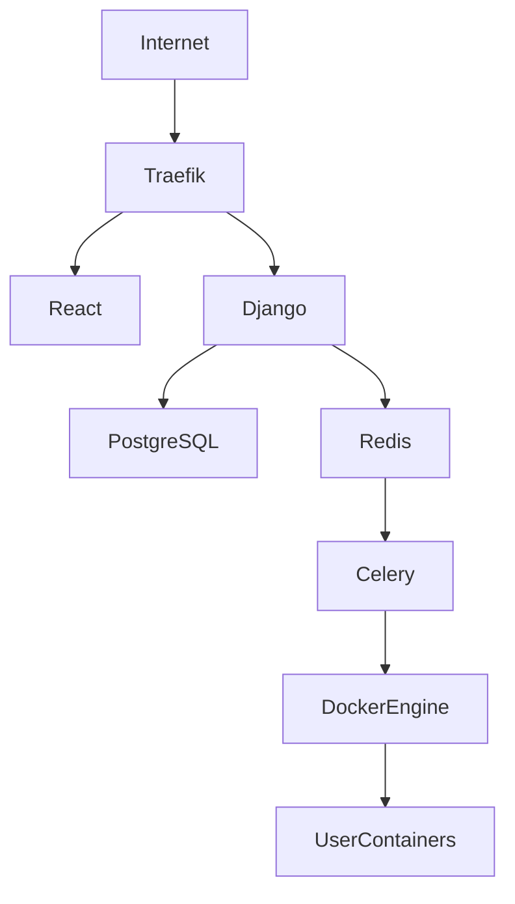

# Desktop Cloud Platform
# Deployment Guide & Infrastructure Specification

**Document Version:** 1.0.0

**Product Version:** MVP (v1.0.0)

**Status:** Approved

**Depends On:**
- 02_System_Architecture.md
- 05_Container_Architecture.md
- 06_Backend_Architecture.md
- 08_Frontend_Architecture.md
- 10_Administration.md
- 11_Analytics_Logging_Monitoring.md

---

# Table of Contents

1. Purpose
2. Deployment Philosophy
3. Environments
4. Infrastructure Overview
5. Local Development
6. Staging Environment
7. Production Environment
8. Directory Structure
9. Environment Variables
10. Docker Compose
11. Reverse Proxy
12. SSL
13. Database Deployment
14. Redis Deployment
15. Backend Deployment
16. Frontend Deployment
17. Celery Deployment
18. Scheduled Jobs
19. Backup Strategy
20. Update Strategy
21. Rollback Strategy
22. Disaster Recovery
23. Production Hardening
24. Future Infrastructure
25. Acceptance Criteria

---

# 1. Purpose

This document defines the deployment architecture for the Desktop Cloud Platform.

It describes:

- Development environment
- Staging environment
- Production deployment
- Infrastructure layout
- Operational deployment standards

---

# 2. Deployment Philosophy

Deployment follows these principles:

- Reproducible
- Environment-driven
- Containerized
- Minimal manual configuration
- Secure by default
- Easy to upgrade
- Easy to recover

Infrastructure should be identical wherever possible.

---

# 3. Environments

The platform supports three environments.

## Development

Purpose:

Local development.

Characteristics:

- Debug enabled
- Local PostgreSQL
- Local Redis
- Local Docker Engine
- Docker Compose

---

## Staging

Purpose:

Pre-production testing.

Characteristics:

- Production-like configuration
- HTTPS enabled
- Real Docker provisioning
- Test data only

---

## Production

Purpose:

Live platform.

Characteristics:

- HTTPS only
- Optimized settings
- Monitoring enabled
- Scheduled backups
- Restricted administrator access

---

# 4. Infrastructure Overview



---

# 5. Local Development

Operating System:

Ubuntu Server VM

Host Machine:

Windows 11

Services:

- Django
- React
- PostgreSQL
- Redis
- Celery
- Docker Engine
- Traefik

Development uses Docker Compose to start all required services.

---

# 6. Staging Environment

Recommended platform:

Single Ubuntu VPS

Suggested provider:

AWS EC2 (or equivalent VPS)

Characteristics:

- Mirrors production
- Uses HTTPS
- Uses production database schema
- Uses isolated Docker network
- Uses test accounts

---

# 7. Production Environment

Recommended initial deployment:

Single Ubuntu server.

Components:

- Traefik
- React
- Django
- PostgreSQL
- Redis
- Celery
- Docker Engine
- User Containers

Future versions may separate these services across multiple hosts.

---

# 8. Directory Structure

Example deployment layout:

```
/opt/dcp/

├── backend/
├── frontend/
├── docker/
├── traefik/
├── postgres/
├── redis/
├── backups/
├── logs/
├── volumes/
├── scripts/
└── .env
```

Persistent user volumes are stored under:

```
/opt/dcp/volumes/
```

---

# 9. Environment Variables

Configuration must be provided through environment variables.

Examples:

```
SECRET_KEY

DEBUG

DATABASE_URL

REDIS_URL

DOCKER_HOST

TRAEFIK_DOMAIN

DEFAULT_CPU_LIMIT

DEFAULT_MEMORY_LIMIT

DEFAULT_AUTO_STOP

LOG_LEVEL
```

Secrets must never be committed to version control.

---

# 10. Docker Compose

Docker Compose is used for local development and can also bootstrap staging.

Services:

- frontend
- backend
- postgres
- redis
- celery
- traefik

User desktop containers are **not** part of the compose file and are created dynamically by DockerManager.

---

# 11. Reverse Proxy

Traefik is the platform reverse proxy.

Responsibilities:

- HTTPS termination
- Dynamic routing
- Session-aware routing
- Hash-based subdomains
- Automatic service discovery

Traefik communicates with Docker to discover running desktop instances.

---

# 12. SSL

HTTPS is mandatory outside local development.

SSL certificates are managed automatically using Let's Encrypt.

Requirements:

- Automatic renewal
- Secure cipher suites
- HTTP to HTTPS redirection

---

# 13. Database Deployment

Database:

PostgreSQL

Recommendations:

- Dedicated data volume
- Daily backups
- Connection pooling (future)
- Restricted network access

Schema changes occur only through Django migrations.

---

# 14. Redis Deployment

Redis provides:

- Celery broker
- Task queue
- Temporary caching

Redis data does not require long-term persistence for the MVP.

---

# 15. Backend Deployment

Backend stack:

- Django
- Django REST Framework
- Gunicorn (recommended)
- Docker SDK

Responsibilities:

- Authentication
- API
- Business logic
- Docker orchestration

Static files should be collected during deployment.

---

# 16. Frontend Deployment

Frontend:

React + Vite

Deployment:

Static build served behind Traefik.

Recommended process:

```
npm install

npm run build
```

The generated build artifacts are deployed independently from the backend.

---

# 17. Celery Deployment

Dedicated Celery workers execute:

- Instance provisioning
- Instance deletion
- Software installation
- Analytics aggregation
- Auto-stop jobs

Workers should restart automatically after failure.

---

# 18. Scheduled Jobs

Scheduled tasks include:

- PostgreSQL backups
- Analytics aggregation
- Log rotation
- Temporary file cleanup
- Future watchdog service

Scheduling may be handled through:

- Celery Beat
- System cron (where appropriate)

---

# 19. Backup Strategy

Daily:

- PostgreSQL dump (`pg_dump`)

Weekly:

- Verify backup integrity

Future:

- Off-site backup replication
- Encrypted backup archives

Persistent user volumes require a separate backup strategy if business requirements demand it.

---

# 20. Update Strategy

Deployment sequence:

1. Backup database
2. Pull latest code
3. Install dependencies
4. Run migrations
5. Collect static files
6. Restart backend
7. Restart frontend
8. Restart Celery
9. Verify platform health

---

# 21. Rollback Strategy

If deployment fails:

1. Stop deployment
2. Restore previous application version
3. Restore database (if required)
4. Verify service health
5. Resume user access

Database migrations should be designed to minimize rollback complexity.

---

# 22. Disaster Recovery

Examples:

## Database Failure

- Restore latest verified backup
- Validate integrity
- Resume service

---

## Docker Failure

- Restore Docker service
- Reconcile instance states
- Restart affected containers

---

## Server Failure

- Provision replacement server
- Restore application
- Restore database
- Reattach persistent volumes (if available)
- Verify platform functionality

Recovery procedures should be tested periodically.

---

# 23. Production Hardening

Before production:

- DEBUG disabled
- HTTPS enforced
- Strong SECRET_KEY
- Secure cookies
- Firewall configured
- SSH key authentication
- Automatic security updates (where appropriate)
- Resource limits verified
- Log rotation configured
- Backup schedule verified

---

# 24. Future Infrastructure

Planned enhancements:

- Multi-host deployment
- Docker Swarm
- Kubernetes
- Horizontal scaling
- Load balancing
- Object storage
- CDN
- Managed PostgreSQL
- Managed Redis
- High availability

These features should build upon the MVP without requiring major architectural redesign.

---

# 25. Acceptance Criteria

Deployment documentation is complete when:

- All environments are defined.
- Infrastructure layout is documented.
- Deployment steps are standardized.
- Backup and rollback strategies are documented.
- Production hardening is defined.
- Future infrastructure evolution is considered.

---

# End of Document