# Desktop Cloud Platform
# Sequence Diagrams

**Document Version:** 1.0.0

**Product Version:** MVP

**Status:** Approved

---

# Table of Contents

1. Purpose
2. Diagram Standards
3. User Registration
4. User Login
5. Create Instance
6. Start Instance
7. Launch Desktop
8. Stop Instance
9. Delete Instance
10. Software Installation Request
11. Admin Software Installation
12. Auto Stop Workflow
13. Event Logging
14. Future Workflows

---

# 1. Purpose

This document defines the runtime interaction between the platform components.

These diagrams complement the architecture documentation and serve as implementation references for developers and AI coding agents.

---

# 2. Diagram Standards

Participants:

- User
- React Frontend
- Django Backend
- Service Layer
- Celery
- Docker Engine
- PostgreSQL
- Redis
- Traefik
- Desktop Container

All diagrams use Mermaid sequence syntax.

---

# 3. User Registration

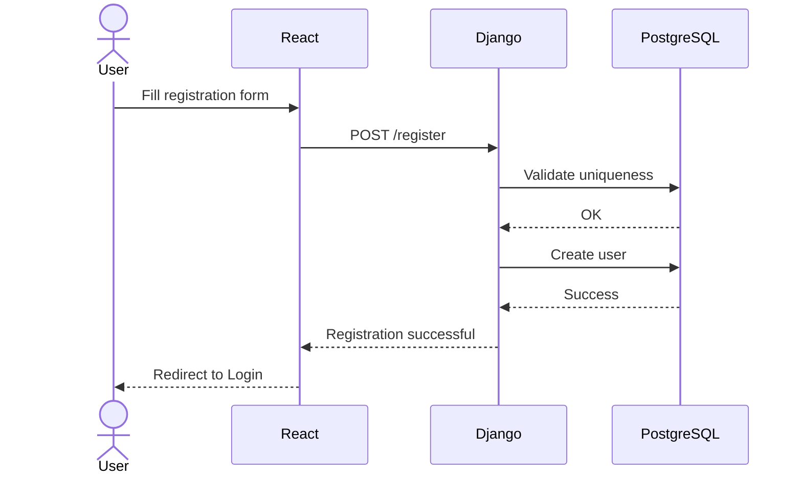

---

# 4. User Login

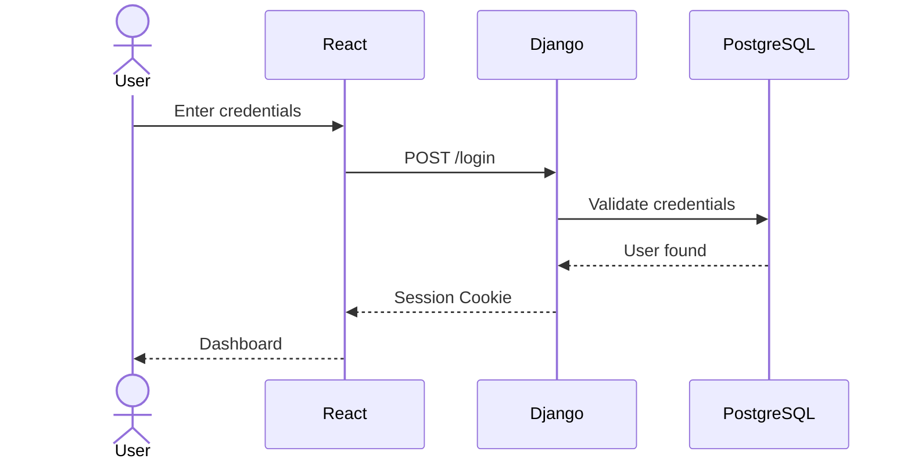

---

# 5. Create Instance

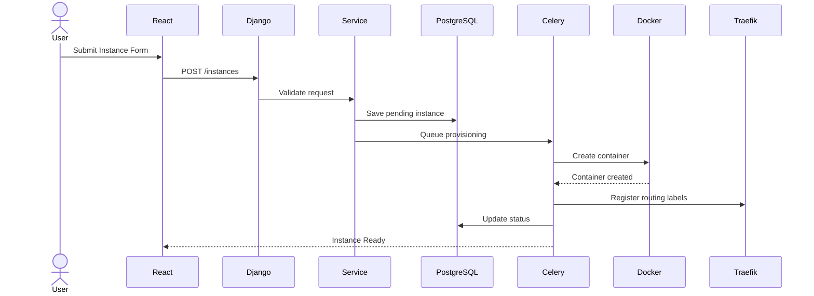

---

# 6. Start Instance

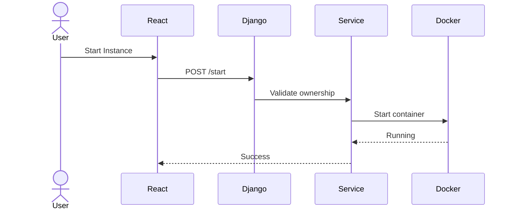

---

# 7. Launch Desktop

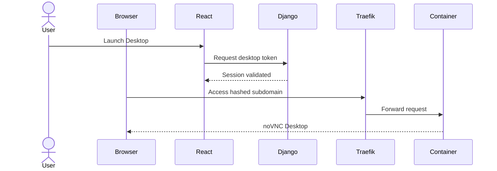

---

# 8. Stop Instance

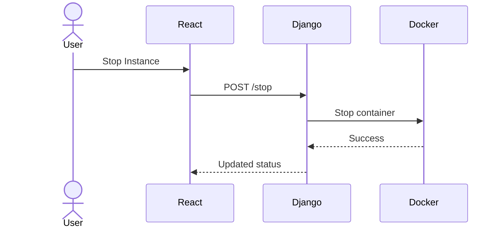

---

# 9. Delete Instance

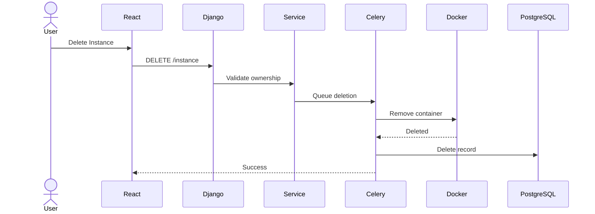

---

# 10. Software Installation Request

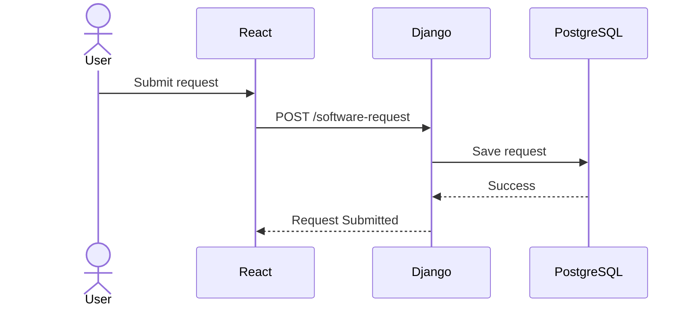

---

# 11. Admin Software Installation

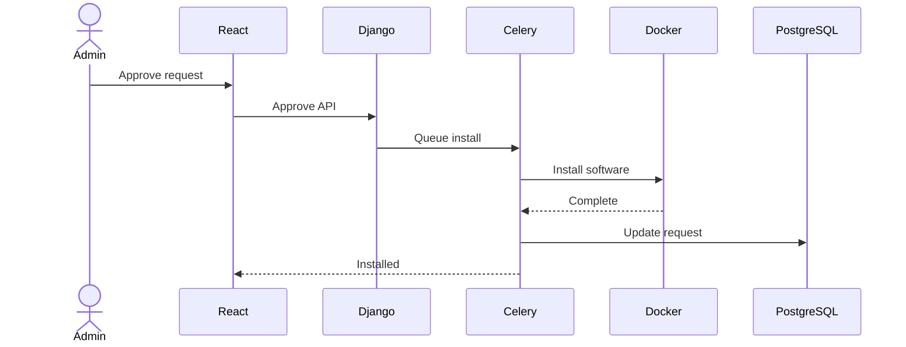

---

# 12. Auto Stop Workflow

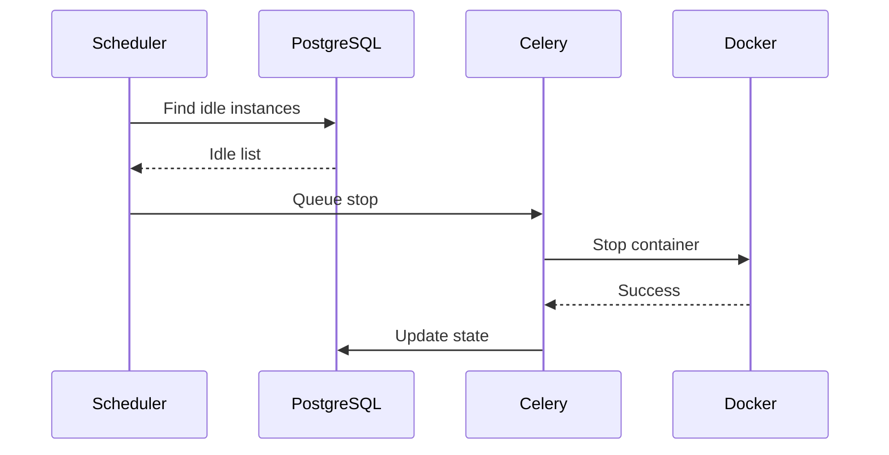

---

# 13. Event Logging

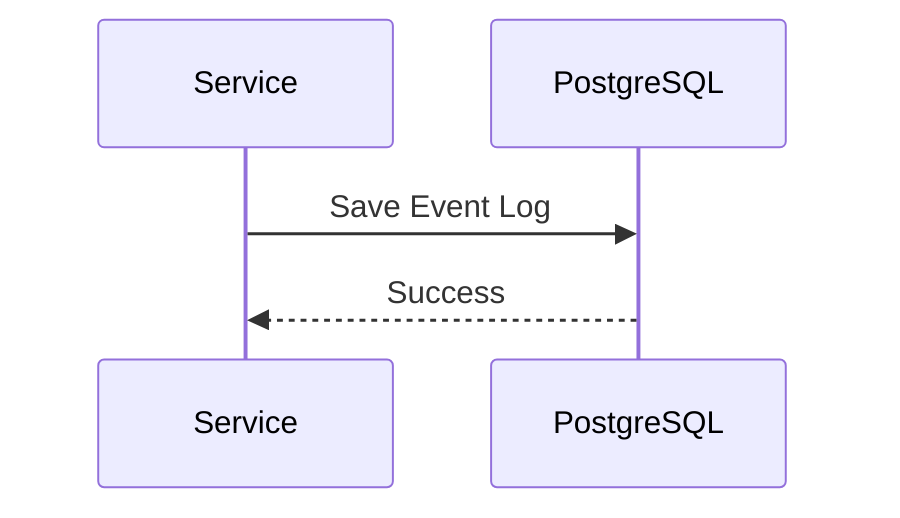

Every important operation should create an Event Log entry.

Examples:

- Login
- Logout
- Instance Created
- Instance Started
- Instance Stopped
- Instance Deleted
- Software Request
- Admin Actions

---

# 14. Future Workflows

Reserved for:

- Billing
- Multi-host scheduling
- Kubernetes orchestration
- Team workspaces
- Snapshots
- Volume migration
- Firecracker provisioning
- API token authentication
- OAuth
- Marketplace deployments

---

# Sequence Diagram Principles

Every major feature added to the platform should include a corresponding sequence diagram.

Sequence diagrams are considered part of the architecture documentation.

---

# End of Document